<div align="center">


# Oruga

**Toda la flota en una sola línea de tiempo.**

Gestión y alquiler de vehículos y maquinaria pesada: reservas, inspecciones, mantenimiento y telemetría<br />
en Maracaibo, Caracas, Valencia y Cúcuta.

[](https://github.com/jxrri/oruga/actions/workflows/ci.yml)


[**Manual de usuario (PDF)**](docs/user-manual/oruga-user-manual.pdf) ·
[Inicio rápido](#inicio-rápido) ·
[Módulos](#módulos) ·
[Roles](#roles-y-permisos) ·
[Arquitectura](#arquitectura)

<br />

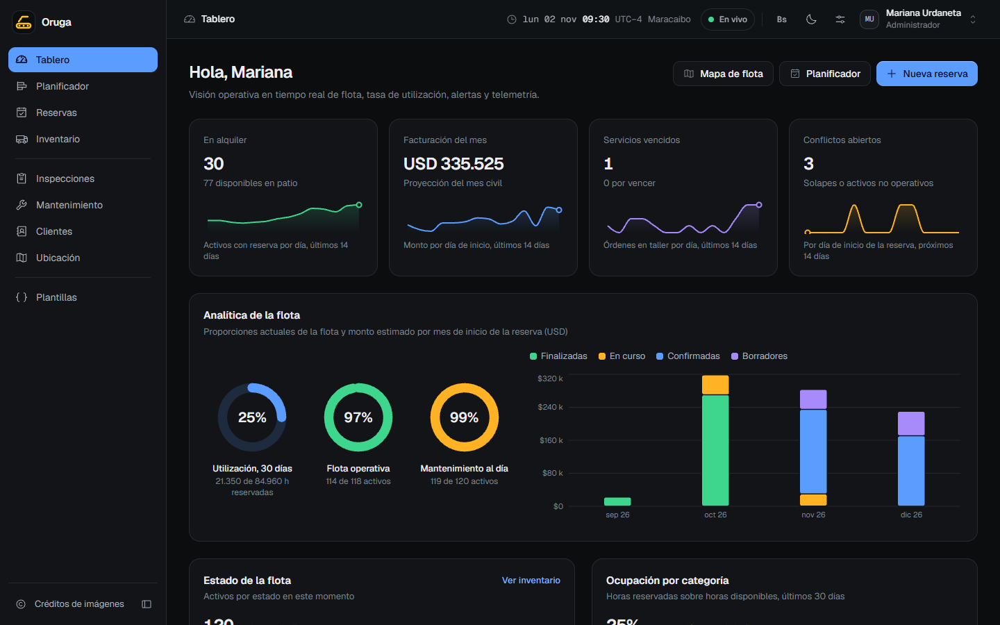

</div>

<br />

## Qué es Oruga

Oruga reúne en un solo lugar el ciclo completo de un alquiler de equipos pesados: el registro de la flota y de los clientes, la reserva con su cotización, la inspección del equipo al salir y al volver del patio, el mantenimiento preventivo y correctivo, y el seguimiento de la ubicación de cada unidad.

Esta es la **fase 1**: un frontend completo y navegable. La API se simula en el navegador con MSW y los datos se guardan en una base local (IndexedDB), así que se puede usar sin servidor.

> [!TIP]
> El [**manual de usuario**](docs/user-manual/oruga-user-manual.pdf) recorre todas las pantallas en 57 páginas con capturas reales, pasos guiados, reglas de negocio y preguntas frecuentes.

## Módulos

| Módulo            | Para qué sirve                                                                                                                         |
| ----------------- | -------------------------------------------------------------------------------------------------------------------------------------- |
| **Tablero**       | Indicadores del negocio, analítica de la flota, alertas que piden una decisión y operaciones del día.                                  |
| **Planificador**  | Calendario de toda la flota: crear, mover, redimensionar y reasignar reservas arrastrándolas, con detección de conflictos al instante. |
| **Reservas**      | Contratos de alquiler con tarifa óptima (mes, semana, día y hora), validación de disponibilidad, estados e historial de cambios.       |
| **Inventario**    | Catálogo en tarjetas o tabla, disponibilidad por rango de fechas, ficha técnica, documentos y estado operativo con bitácora.           |
| **Inspecciones**  | Formularios generados desde plantillas, campos condicionales, veredicto automático y comparación entre salida y devolución.            |
| **Mantenimiento** | Órdenes de taller preventivas y correctivas, y planes que vencen por horas, kilómetros o días.                                         |
| **Clientes**      | Directorio con validación de RIF y cédula, bloqueo administrativo e historial de contratos.                                            |
| **Ubicación**     | Mapa en vivo con la posición de cada activo cada 4 segundos y alertas de geocerca alrededor de las obras.                              |
| **Plantillas**    | Editor de los formularios de inspección con vista previa interactiva y versiones.                                                      |

<table>
  <tr>
    <td width="50%">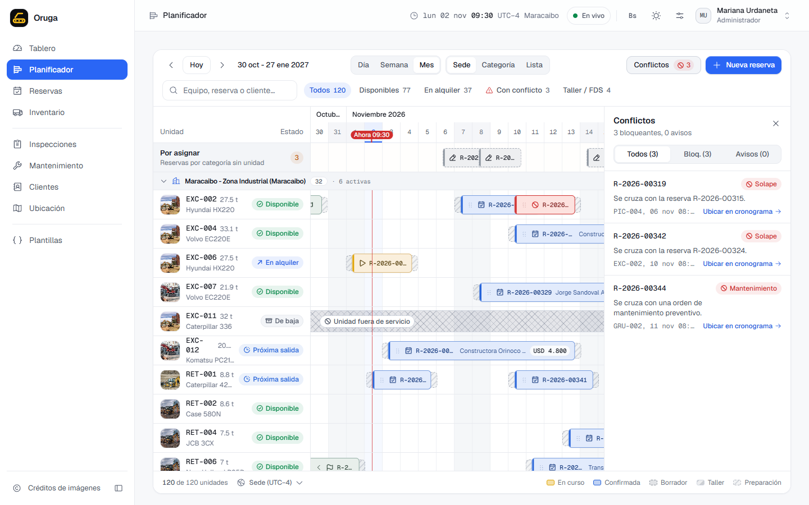<br /><sub><b>Planificador.</b> Toda la flota en una línea de tiempo, con panel de conflictos.</sub></td>
    <td width="50%">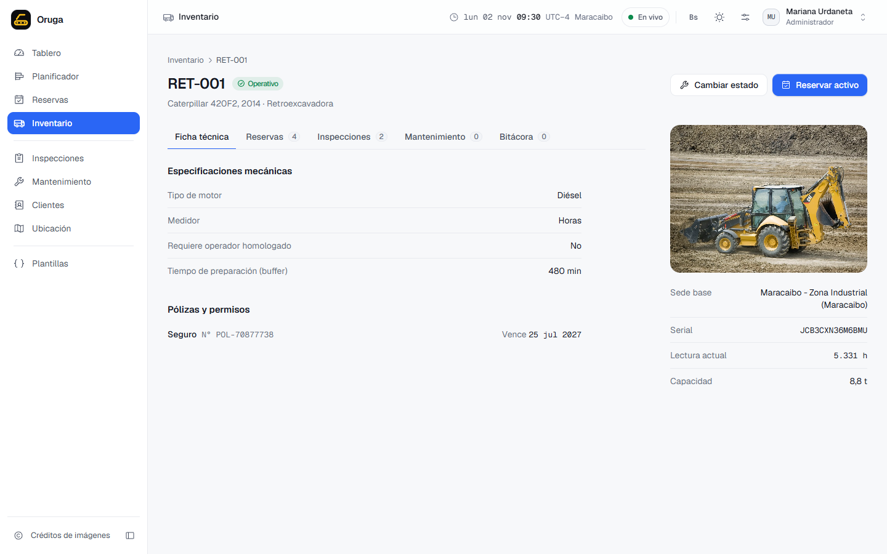<br /><sub><b>Inventario.</b> Ficha técnica, pólizas y estado operativo de cada unidad.</sub></td>
  </tr>
  <tr>
    <td>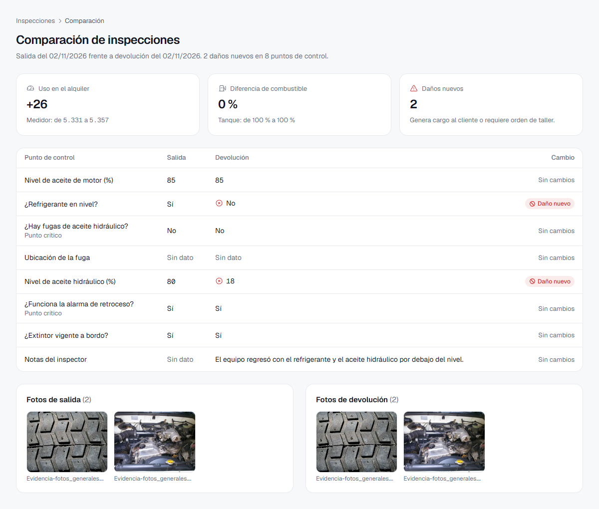<br /><sub><b>Inspecciones.</b> Salida frente a devolución, con los daños nuevos marcados.</sub></td>
    <td>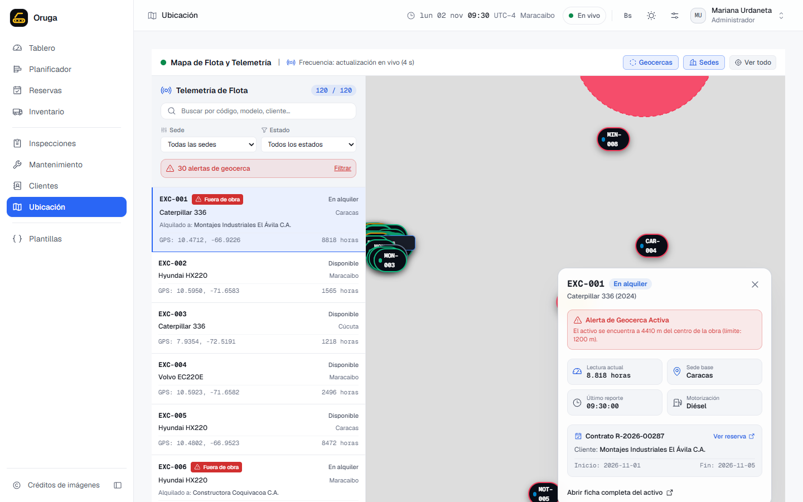<br /><sub><b>Ubicación.</b> Telemetría en vivo y alerta cuando un equipo sale de su obra.</sub></td>
  </tr>
  <tr>
    <td>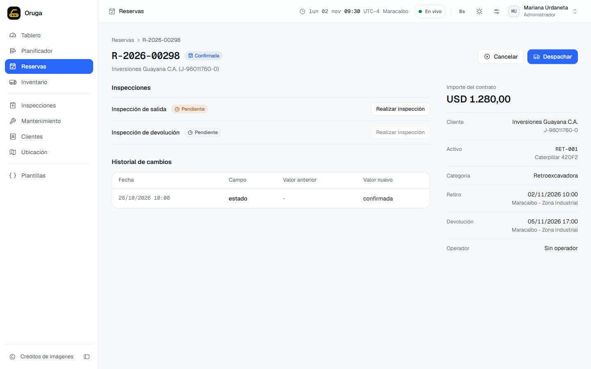<br /><sub><b>Reservas.</b> Estado, inspecciones pendientes e historial de cambios.</sub></td>
    <td>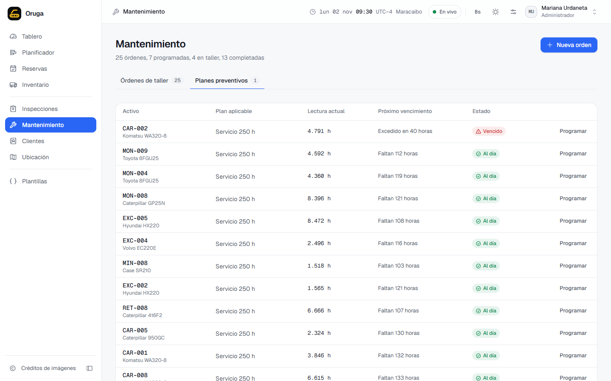<br /><sub><b>Mantenimiento.</b> Próximo vencimiento de cada activo según su plan.</sub></td>
  </tr>
</table>

## El ciclo de un alquiler

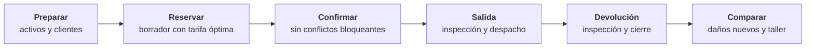

Cada reserva avanza por estados y cada paso tiene su requisito:

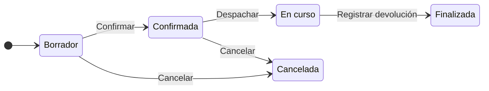

| Acción                   | Requisito                                                                                                                          |
| ------------------------ | ---------------------------------------------------------------------------------------------------------------------------------- |
| **Confirmar**            | Unidad asignada, cliente sin bloqueo y sin conflictos bloqueantes (solape, mantenimiento, unidad no operativa, documento vencido). |
| **Despachar**            | Inspección de salida registrada y que no sea "No apto".                                                                            |
| **Registrar devolución** | Inspección de devolución registrada, con cualquier veredicto.                                                                      |
| **Cancelar**             | Un motivo escrito. Solo desde borrador o confirmada.                                                                               |

## Roles y permisos

Cada cuenta tiene un rol. Oruga **oculta** lo que el rol no puede usar en lugar de mostrarlo deshabilitado.

| Módulo                  | Administrador |    Planificador     |        Inspector        |    Mantenimiento     | Gerente |
| ----------------------- | :-----------: | :-----------------: | :---------------------: | :------------------: | :-----: |
| Tablero                 |     Total     |         Ver         |            —            |         Ver          |   Ver   |
| Planificador y Reservas |     Total     |        Total        | Ver, entregar y recibir |         Ver          |   Ver   |
| Inventario              |     Total     |         Ver         |           Ver           | Ver y cambiar estado |   Ver   |
| Inspecciones            |     Total     |         Ver         |       Ver y crear       |         Ver          |   Ver   |
| Mantenimiento           |     Total     |         Ver         |           Ver           |        Total         |   Ver   |
| Clientes                |     Total     | Ver, crear y editar |           Ver           |          —           |   Ver   |
| Ubicación               |     Total     |         Ver         |           Ver           |         Ver          |   Ver   |
| Plantillas              |     Total     |          —          |            —            |          —           |   Ver   |

## Inicio rápido

Necesitas **Node.js 20+** y **npm 10+**.

```bash
npm install
npm run dev
```

Abre la dirección que muestra la terminal (normalmente `http://localhost:5173`) y entra con una de las cuentas de demostración. Todas usan la clave **`oruga2026`**, y la pantalla de acceso las rellena con un toque.

| Persona               | Rol                   | Correo                             |
| --------------------- | --------------------- | ---------------------------------- |
| Mariana Urdaneta      | Administrador         | `mariana.urdaneta@oruga.com.ve`    |
| Luis Alberto Ferrer   | Planificador          | `luis.ferrer@oruga.com.ve`         |
| José Gregorio Morillo | Inspector de patio    | `jose.morillo@oruga.com.ve`        |
| Carlos Briceño        | Jefe de mantenimiento | `carlos.briceno@oruga.com.ve`      |
| Andreína Colmenares   | Gerente               | `andreina.colmenares@oruga.com.ve` |

<table>
  <tr>
    <td width="62%">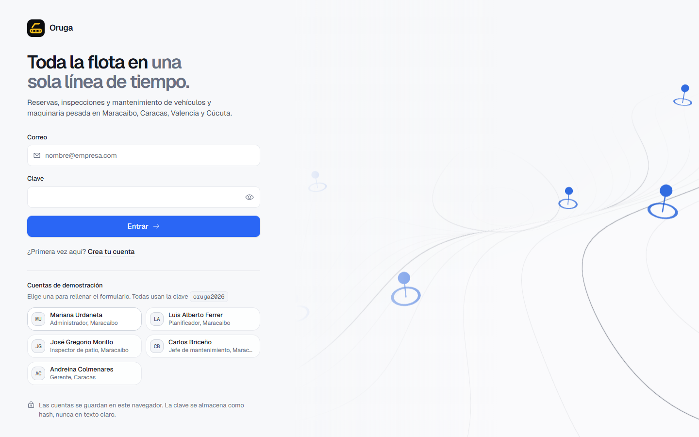</td>
    <td width="38%">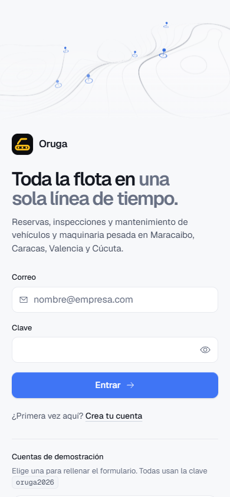</td>
  </tr>
</table>

> [!IMPORTANT]
> Abre Oruga desde `localhost` o un sitio con HTTPS: la protección de las claves usa Web Crypto, que el navegador solo habilita en contextos seguros.

### Cuentas y datos locales

- **La base arranca vacía.** Solo vienen los catálogos (sedes, categorías, plantillas, planes de mantenimiento) y las cinco cuentas de demostración. Los activos, clientes y reservas los registras tú.
- **Todo vive en el navegador.** IndexedDB, base `keyval-store`: las cuentas en `oruga.cuentas` y los datos operativos en `oruga.datos`. Otro navegador o una ventana privada tienen su propia base.
- **Claves protegidas.** Se guarda una sal aleatoria por cuenta y el hash PBKDF2-SHA256 (600 000 iteraciones); nunca la clave en claro. Al entrar se emite un token que viaja como `Authorization: Bearer`; si el servidor simulado no lo reconoce, responde 401 y la app vuelve al acceso.
- **Reloj de demostración.** La app arranca siempre el lunes 2 de noviembre de 2026 a las 09:30 (hora de Maracaibo) y avanza en tiempo real. Se cambia con `VITE_DEMO_HOY`.
- **Panel de desarrollo.** Desde la cabecera permite simular latencia y errores, pausar el tiempo real y vaciar la base local.

Con un backend real basta con definir `VITE_API_URL`: MSW se desactiva y las mismas pantallas llaman a la API.

## Manual de usuario

El manual en PDF está en [`docs/user-manual/oruga-user-manual.pdf`](docs/user-manual/oruga-user-manual.pdf). Tiene 17 capítulos: primeros pasos, la interfaz, roles, el recorrido completo de un alquiler, un capítulo por módulo, preguntas frecuentes y glosario.

Se genera desde el código con capturas reales de la aplicación:

```bash
npm run manual       # levanta Vite, captura las pantallas con Playwright y arma el PDF
npm run manual:pdf   # solo vuelve a armar el PDF desde docs/user-manual/manual.html
```

Usa el Chromium de Playwright (`npx playwright install chromium`) o cualquier navegador basado en Chromium indicado en `BROWSER_PATH`.

## Comandos

| Comando             | Qué hace                                                     |
| ------------------- | ------------------------------------------------------------ |
| `npm run dev`       | Servidor de desarrollo con MSW y telemetría simulada.        |
| `npm run build`     | Verificación de tipos y compilación de producción.           |
| `npm run typecheck` | TypeScript estricto.                                         |
| `npm run lint`      | ESLint con reglas de accesibilidad (jsx-a11y) y de hooks.    |
| `npm test`          | Pruebas unitarias y de integración con Vitest.               |
| `npm run test:tz`   | Pruebas de zona horaria en `America/Caracas` y `Asia/Tokyo`. |
| `npm run manual`    | Regenera el manual de usuario en PDF.                        |

## Arquitectura

```text
src/
├── api/        Contrato de tipos (contrato.ts) y cliente RTK Query con caché compartida
├── domain/     Reglas de negocio puras: conflictos, máquina de estados, tarifas, vencimientos, inspección
├── mocks/      API simulada con MSW, base local en IndexedDB, cuentas y eventos en tiempo real
├── shared/     Kit de interfaz sobre Radix UI, tokens, fechas con zona IANA y formateadores
├── features/   Un módulo por carpeta, con carga perezosa y Error Boundary propio
└── app/        Shell, rutas, permisos por rol y estado de interfaz
```

**Stack:** React 19 · TypeScript · Vite · Tailwind CSS 4 · Redux Toolkit y RTK Query · React Router 7 · Radix UI · GSAP · Three.js · Leaflet · Recharts · MSW · Vitest.

El contrato de diseño que siguen todas las pantallas está en [`docs/DISENO.md`](docs/DISENO.md).

## Créditos

Las fotografías de equipos y escenas provienen de Wikimedia Commons con licencias libres. El detalle de autores y licencias está en [`public/img/LICENCIAS.md`](public/img/LICENCIAS.md) y en la pantalla **Créditos de imágenes** de la aplicación.
